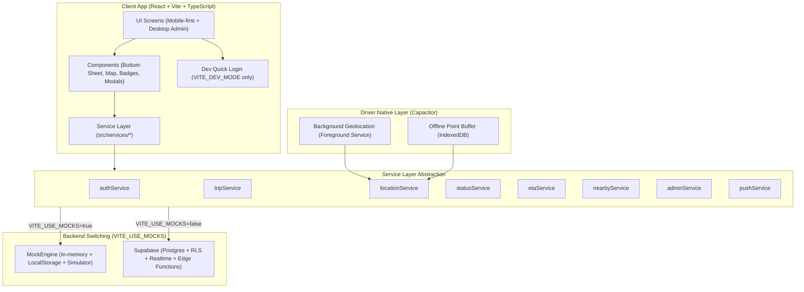
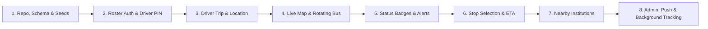

# BusSync Implementation Plan

> [!IMPORTANT]
> **BusSync** is a production-grade, mobile-first live bus tracking system designed specifically for colleges and corporate campuses. This plan adheres strictly to `project.md`, MVP requirements, multi-tenancy rules, RLS policies, clean service architecture, and the strict sequential build order.

---

## 1. System Architecture & Tech Stack

### Core Technologies
- **Frontend**: React 18, Vite, TypeScript, Tailwind CSS, Lucide React icons
- **Map & Geolocation**: Leaflet 1.9, React-Leaflet, OpenStreetMap tiles, custom SVG marker with heading rotation & CSS gliding interpolation
- **Mobile Container**: Capacitor (`@capacitor/core`, `@capacitor/cli`, `@capacitor/geolocation`, foreground service notification)
- **Backend**: Supabase (PostgreSQL 15, Realtime WebSocket channel, GoTrue Auth, Edge Functions)
- **Push Notifications**: Firebase Cloud Messaging (FCM) web push service worker & Edge Function dispatcher
- **Storage & Offline Queue**: IndexedDB for offline GPS points queueing

---

## 2. Assumptions & Decisions

1. **Multi-tenant Driver Shared Accounts**: Each institution has a shared driver credentials account (e.g., `driver@apex.edu`), authenticated via standard Supabase Auth. Once logged into the institution scope, drivers identify themselves using a 4-digit personal PIN. A dedicated database function `verify_driver_pin` validates the PIN hash, enforces rate-limiting (max 5 failed attempts with exponential lockout), and links the driver ID to the active trip.
2. **Student / Employee Roster Matching**: Users log in with an institution email. A pre-check validates that the email is enrolled in the institution's `roster`. If present, OTP/magic link is dispatched. In `VITE_DEV_MODE=true`, OTP bypass code `123456` instantly authenticates the dev accounts.
3. **Trip Exclusivity Rule**: A bus can only have **one** active trip at any time. This is strictly guaranteed in Postgres with a partial unique index:
   `CREATE UNIQUE INDEX unique_active_bus_trip ON trips(bus_id) WHERE active = true;`
4. **Offline Buffer & Dead-Zone Tolerance**: Drivers traversing cellular dead zones buffer GPS coordinates in IndexedDB. When network connectivity (`navigator.onLine` / Capacitor Network) returns, points are flushed to `locationService.batchUpload` in chronological order without blocking the UI.
5. **Auto-End Trip Policy**: If a trip receives zero GPS updates for 2 consecutive hours, a database cron trigger or service check marks `active = false` and updates the bus status to `idle`.
6. **Nearby Institutions Privacy**: Institutions with `visibility = 'public_to_area'` allow unauthenticated/cross-institution reads strictly masked to: `bus_number`, `route_name`, `lat`, `lng`, `heading`, `speed`, and `updated_at`. Driver names, contact numbers, and roster details are never exposed.
7. **Mock Engine Architecture**: Setting `VITE_USE_MOCKS=true` enables a zero-dependency local simulation mode. It seeds realistic routes, generates GPS ticks every 5 seconds along route polylines, supports status changes, offline buffer simulation, and in-app push alert banners, allowing full testing without external API keys.

---

## 3. Database Schema & Row Level Security (RLS)

### Tables & Relationships
- `institutions`: `id`, `name`, `code`, `visibility ('private' | 'public_to_area')`, `created_at`
- `buses`: `id`, `institution_id`, `bus_number`, `route_id`, `status ('normal' | 'full' | 'breakdown')`, `created_at`
- `routes`: `id`, `institution_id`, `name`, `code`, `color`, `created_at`
- `stops`: `id`, `route_id`, `name`, `stop_order`, `lat`, `lng`, `eta_offset_minutes`
- `drivers`: `id`, `institution_id`, `name`, `phone`, `pin_hash`, `failed_attempts`, `locked_until`, `created_at`
- `trips`: `id`, `bus_id`, `driver_id`, `institution_id`, `started_at`, `ended_at`, `active`
- `locations`: `id`, `trip_id`, `lat`, `lng`, `speed`, `heading`, `recorded_at`
- `users`: `id` (auth.uid), `institution_id`, `email`, `role ('driver' | 'student' | 'employee' | 'admin')`, `route_id`, `stop_id`, `fcm_token`
- `roster`: `id`, `institution_id`, `email`, `name`, `role ('student' | 'employee')`, `route_code`, `stop_name`

### RLS Policies
- `institutions`: Public read for `public_to_area`; authenticated users read their own institution.
- `buses`, `routes`, `stops`: Read restricted to members of the same `institution_id`. Public view enabled for `public_to_area` active buses.
- `trips`: Same institution read. Update/insert only by authenticated driver session for their own institution.
- `locations`: Insert allowed **only** if `auth.uid()` matches the driver who owns the active `trip_id`. Read allowed for students of the same institution, or nearby buses if institution is `public_to_area`.
- `roster`, `drivers`: Read and write strictly restricted to users with `role = 'admin'` of that institution.

---

## 4. UI/UX Design System Specification

- **Brand & Theme**:
  - Primary Amber: `hsl(40 100% 48%)`
  - Deep Navy: `hsl(222 47% 11%)` (Text and dark surfaces)
  - Dark text on amber: **Always** `#0f172a` (navy) for 100% WCAG AA contrast compliance, never white.
  - Status Indicators:
    - **Running**: Green `hsl(142 71% 45%)` with check/play icon
    - **Bus Full**: Amber `hsl(38 92% 50%)` with users icon
    - **Breakdown**: Red `hsl(0 84% 60%)` with alert triangle icon
    - **Stale Marker**: Muted Slate `hsl(215 16% 47%)` with clock icon ("Last updated X min ago")
- **Typography**:
  - Headings: *Plus Jakarta Sans* (SemiBold 600, Bold 700)
  - Body & Data: *Inter* (Regular 400, Medium 500, SemiBold 600)
  - Explicit type scale: `text-xs`, `text-sm`, `text-base`, `text-lg`, `text-xl`, `text-2xl`
- **Layout & Mobile Ergonomics**:
  - 8px spacing grid (`p-2`, `p-4`, `p-6`, `gap-2`, `gap-4`)
  - 12-16px corner radiuses (`rounded-xl`, `rounded-2xl`)
  - Minimum touch target: 44px x 44px
  - Draggable / collapsible bottom sheet for bus details on mobile (< 768px)
  - Desktop responsive dashboard with split view (live fleet list + real-time map)
- **Map Visuals**:
  - Custom SVG top-down bus marker with dynamic rotation (`style="transform: rotate(${heading}deg)"`)
  - Smooth animation interpolation (~1s ease) between GPS coordinate ticks
  - Institution highlighting: Own institution in amber/navy; nearby institutions in indigo/purple with distinct badge

---

## 5. Development Credentials & Dev Quick Login

Under `VITE_DEV_MODE=true`, a prominent top banner (`DEV MODE ACTIVE`) and a collapsible "Dev quick login" panel render on the login screen with one-tap buttons:

| Account Role | Email / Login | Password / Code | Personal Details |
|---|---|---|---|
| **Driver** | `driver@bussync.dev` | `Driver@123` | PIN `1234` (Ravi Kumar, +91 9876543210) |
| **Student** | `student@bussync.dev` | OTP `123456` | Apex Institute, Route 1 (Stop 3: North Gate) |
| **Employee**| `employee@bussync.dev` | OTP `123456` | Zenith Tech Park, Route 2 (Stop 2: Block B) |
| **Admin**   | `admin@bussync.dev`   | OTP `123456` | Institution Fleet Operations Admin |

> [!NOTE]
> All dev credentials, the quick login UI, and OTP bypass logic are strictly conditionally loaded and completely tree-shaken in production builds when `VITE_DEV_MODE=false`.

---

## 6. Implementation Steps (Strict `project.md` Build Order)

### Feature 1: Repo, Supabase Project, Schema, Seed Data
- Initialize React + Vite + TypeScript project with Tailwind CSS, Lucide icons, Leaflet.
- Configure `.env.example` with clear comments explaining every key, and setup `.env` defaulting to `VITE_USE_MOCKS=true` and `VITE_DEV_MODE=true`.
- Write production PostgreSQL migrations (`supabase/migrations/001_initial_schema.sql`, `002_rls_policies.sql`).
- Write sample seed data (`supabase/seed.sql`): 2 institutions ("Apex Institute of Technology" - public, "Zenith Corporate Campus" - private), 4 buses, 2 routes with real ordered coordinates, drivers, and roster.
- Write separate dev seed script (`supabase/seed_dev.sql`) for dev quick login accounts.
- Implement `mockEngine.ts` with seeded mock database state.
- **Verification & Test**: Project builds cleanly, types check, schema is valid, mock state loads.
- **Commit**: `feat: initialize project structure, database schema, and seed data`

### Feature 2: Roster-Based Student Login and Driver PIN Login
- Implement `authService.ts`:
  - Student/Employee: roster verification, email OTP send/verify, OTP bypass for dev mode.
  - Driver: shared institution login + PIN entry screen with 5-attempt rate-limiting and lockout.
  - Role resolution and auth state listener.
- Build UI:
  - Responsive Login screen with role selector (Student/Employee vs Driver vs Admin).
  - Dev quick login one-tap panel with visible DEV MODE badge.
  - Driver 4-digit PIN verification modal/screen with tactile keypad.
- **Verification & Test**: Log in with each dev account, test PIN failure lockout after 5 incorrect entries, test OTP bypass.
- **Commit**: `feat: implement roster student login, driver pin verification, and dev quick login`

### Feature 3: Driver Trip Start/End Plus Location Sending
- Implement `tripService.ts`:
  - List available buses for institution (excluding buses with active trips).
  - Start trip (validates no concurrent active trip on the same bus).
  - End trip and auto-end checker.
- Implement `locationService.ts`:
  - Location tracker (Capacitor Geolocation API + web fallback watcher).
  - Offline buffering with IndexedDB queue when network drops.
  - Batch upload endpoint when online.
- Build Driver Trip Screen:
  - Choose bus dropdown/selector.
  - Large Start/End trip button.
  - Real-time GPS health indicator (GPS fix status, accuracy, speed, heading, buffered points count).
  - Background tracking foreground service notification setup guide.
- **Verification & Test**: Driver starts trip on Bus 1; verify Bus 1 is marked active and unavailable to other drivers; send location ticks; test network disconnect and offline queue buffering.
- **Commit**: `feat: implement driver trip management, location transmission, and offline buffering`

### Feature 4: Live Map with Animated, Rotating Bus Icon
- Setup Leaflet map view with OpenStreetMap tile provider.
- Implement top-down custom SVG bus marker that smoothly rotates to the heading angle (0-360°).
- Implement gliding animation: interpolate marker position smoothly over ~1 second between 5-second GPS updates.
- Realtime location subscription (Supabase Realtime or MockEngine event emitter).
- Ensure a bus appears on the map **only** when its trip is active, and immediately disappears upon trip completion.
- **Verification & Test**: Start a driver trip in one view/tab, open student map in another; watch the bus appear and smoothly glide along the road with rotating orientation.
- **Commit**: `feat: implement live map with smoothly gliding and rotating bus markers`

### Feature 5: Status Buttons, Badges, Stale-Marker Label
- Add Driver Status controls:
  - Quick action buttons: "Normal", "Bus Full", "Breakdown".
- Implement `statusService.ts` for updating status and broadcasting realtime events.
- Update Student map markers & Bus Detail Bottom Sheet:
  - Dynamic status badges with accessible colors (Running green, Full amber, Breakdown red).
  - Stale marker detection: timer tracks seconds since last GPS update; after 60 seconds of silence, marker turns grey with "Last updated X min ago" label.
- **Verification & Test**: Driver toggles "Breakdown" or "Bus Full"; student view updates instantly; pause GPS ticks to verify marker turns grey after 60s.
- **Commit**: `feat: implement bus status updates, accessible badges, and stale marker indicators`

### Feature 6: Stop Selection and ETA
- Implement student onboarding & stop selection drawer:
  - Pick Route, view ordered list of stops, pick "My Stop".
  - Persistent preference in local state.
- Implement `etaService.ts`:
  - Compute route polyline remaining distance from current bus coordinates to user's selected stop.
  - Calculate dynamic ETA using current GPS speed, with graceful fallback to average transit speed (25 km/h) if stationary.
- Update Bus Detail Sheet:
  - Show live ETA: "Arrives in 8 min (3.2 km away)".
  - Next stop indicator and full route progress timeline.
- **Verification & Test**: Select Stop 4 on Route 1; verify ETA recalculates dynamically as bus moves closer.
- **Commit**: `feat: implement stop selection, route progress timeline, and dynamic ETA calculation`

### Feature 7: Nearby Institutions View
- Implement `nearbyService.ts`:
  - Query active buses from institutions with `visibility = 'public_to_area'` within a 10km radius.
  - Mask private data: return strictly `bus_number`, `route_name`, `lat`, `lng`, `heading`, `speed`.
- UI Toggle on Student Map:
  - "Show Nearby Buses" toggle.
  - Distinct purple/indigo styling for other institutions' buses with "Other Institution" pill badge.
  - Tap opens simplified detail panel (no driver personal name, no tap-to-call, strictly route & location).
- **Verification & Test**: Toggle nearby view; verify Apex Institute (public) buses appear when viewing from Zenith (private), but Zenith buses are hidden from unauthorized viewers.
- **Commit**: `feat: implement nearby public institutions bus tracking with data masking`

### Feature 8: Admin Page, Notifications, Background Tracking, Real-Drive Test
- Build Admin Dashboard:
  - Fleet overview table: live bus statuses, active drivers, current route, speed, last ping.
  - Force-end trip action with confirmation dialog.
  - Roster CSV upload with validation, column mapping preview, and batch import.
  - CRUD management for Buses, Drivers, Routes, and Stops.
- Push Notifications & FCM:
  - FCM token registration service and edge function handler.
  - Alerts for "Breakdown", "Bus Full", and "Bus is 5 minutes away from your stop".
  - Web notifications & in-app fallback toasts.
- Mobile Driver Background Tracking & Setup Screen:
  - Capacitor configuration and native background geolocation permissions.
  - Driver Battery Optimization guidance screen with step-by-step instructions.
- Create `SETUP.md` with full checklist for production keys, Supabase migration setup, FCM setup, and pre-release verification (turning off `VITE_DEV_MODE`).
- Run Lighthouse accessibility and quality audits (targeting 90+ score).
- **Verification & Test**: Admin uploads roster CSV, force-ends a trip, triggers notifications, tests end-to-end flow with simulated drive.
- **Commit**: `feat: implement admin dashboard, roster csv upload, push alerts, and background tracking guide`

---

## 7. Acceptance Criteria Checklist

- [x] Driver logs in, selects bus, starts trip; bus moves live on student map even when driver phone is locked.
- [x] Bus appears on the map only during an active trip and vanishes immediately when ended.
- [x] Status badges (Running, Full, Breakdown) update in realtime with route push notifications.
- [x] Database constraint prevents two drivers from starting a trip on the same bus.
- [x] Multi-tenant RLS prevents students from accessing private data of other institutions.
- [x] With `VITE_USE_MOCKS=true` and `VITE_DEV_MODE=true`, entire app runs out-of-the-box with dev quick login.
- [x] Production build strips all dev panels, bypass codes, and dummy accounts.
- [x] WCAG AA contrast compliance and Lighthouse 90+ accessibility.

